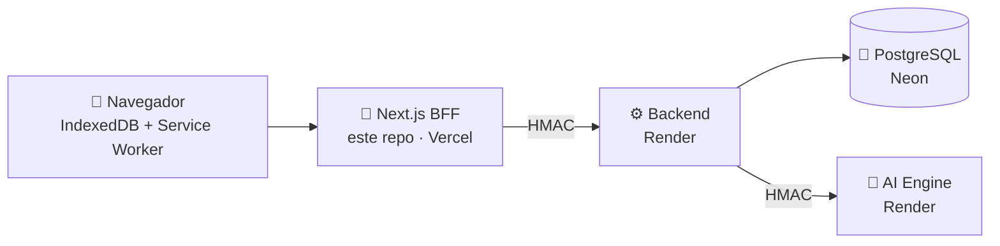

# 🎨 PanelVault · Frontend

> **Tu biblioteca de cómics, viñeta por viñeta.** Interfaz web de PanelVault: importa tus cómics (CBZ, PDF o imágenes), léelos **con o sin internet** y deja que la IA te guíe **cuadro por cuadro**, en orden occidental o manga.

🌐 **Demo en vivo:** <https://panelvault-frontend.vercel.app>


| | |
|---|---|
| 👨‍💻 **Desarrollado por** | David Fernando Ramírez de la Parra |
| 👨‍🏫 **Profesor** | Jhonatan Andrés Mideros Narváez |
| 📚 **Asignatura** | Programación Orientada a la Web |
| 🏛️ **Institución** | Universidad Cooperativa de Colombia |

---

## 📑 Contenido

1. [El caso de estudio](#-el-caso-de-estudio)
2. [Funcionalidades](#-funcionalidades)
3. [Stack](#-stack)
4. [Cumplimiento del caso de estudio](#-cumplimiento-del-caso-de-estudio)
5. [Los 5 patrones de renderizado](#-los-5-patrones-de-renderizado)
6. [Fundamentos del navegador aplicados](#-fundamentos-del-navegador-aplicados)
7. [Arquitectura de 7 capas](#-arquitectura-de-7-capas)
8. [Estructura del código](#-estructura-del-código)
9. [Seguridad](#-seguridad)
10. [Offline-first](#-offline-first)
11. [Sistema de diseño](#-sistema-de-diseño)
12. [Ejecutar en local](#-ejecutar-en-local)
13. [Variables de entorno](#-variables-de-entorno)
14. [Pruebas y calidad](#-pruebas-y-calidad)
15. [Despliegue](#-despliegue)
16. [Estado del proyecto](#-estado-del-proyecto)

---

## 📖 El caso de estudio

**Caso de estudio 1: Gestor de Cómics Digitales Offline-First con Análisis Visual Inteligente.**

Plataforma web de alto rendimiento para la **lectura, organización y gestión de cómics digitales** y novelas gráficas. El usuario carga sus colecciones arrastrando y soltando; el despaquetado de las páginas ocurre **fuera del hilo de la interfaz** para evitar congelamientos, y la lectura es fluida **tanto en línea como totalmente fuera de línea**.

La **IA es co-protagonista**: un sistema de visión por computador en el servidor detecta los bordes de cada viñeta y su orden de lectura, y el visor lo usa para hacer **zoom automático viñeta por viñeta**.

PanelVault está dividido en **tres repositorios independientes**:

| Repositorio | Rol |
|---|---|
| 🎨 **`panelvault-frontend`** (este) | Interfaz web, BFF, offline-first |
| ⚙️ [`panelvault-backend`](https://github.com/dramirezdlp99/panelvault-backend) | API, seguridad, cola de análisis y datos (Spring Boot) |
| 🧠 [`panelvault-ai-engine`](https://github.com/dramirezdlp99/panelvault-ai-engine) | Visión por computador (Python + OpenCV) |

---

## ✨ Funcionalidades

| Pantalla | Qué hace |
|---|---|
| 🏠 **Portada** | Presentación del proyecto y clásicos de dominio público |
| 🗂️ **Catálogo** | Obras públicas con búsqueda y paginación; ficha de cada obra |
| 🔐 **Ingreso / registro** | Cuenta nueva, inicio de sesión y verificación en dos pasos (código TOTP o de recuperación) |
| 📚 **Biblioteca** | Importa CBZ, PDF o imágenes arrastrando y soltando; todo se guarda en el dispositivo; filtros, búsqueda y estadísticas |
| 📘 **Detalle del cómic** | Datos, edición, dirección de lectura, marcadores y borrado |
| 👁️ **Lector** | Página completa o **viñeta por viñeta** con el mapa de la IA; occidental o manga; teclado y gestos; contornos de viñetas; marcadores |
| ⏱️ **Leyendo** | Lecturas recientes con el progreso de todos tus dispositivos |
| 🔖 **Marcadores** | Todas las páginas marcadas, con notas editables |
| 🔬 **Análisis** | Sube una página y ve las viñetas detectadas, su confianza y el tiempo de cada etapa de la IA |
| 🛠️ **Curaduría** | (rol CURADOR) Crear, editar, publicar y borrar obras del catálogo |
| 🛡️ **Seguridad** | Activar la 2FA con código QR y códigos de recuperación |
| 🧪 **Laboratorio** | Event Loop, Web/Shared Workers, memoria compartida, bloqueo y desbloqueo del hilo principal e INP, en vivo |

---

## 🧰 Stack

| | Tecnología | Para qué |
|---|---|---|
| ▲ | **Next.js 16** (App Router) | Los 5 patrones de renderizado y el BFF |
| ⚛️ | **React 19** + **TypeScript** estricto | Componentes y tipos |
| 🎨 | **Tailwind CSS 4** | Sistema de diseño propio ("cómic editorial") |
| 🗄️ | **IndexedDB** (`idb`) | Biblioteca local: cómics, páginas, progreso, marcadores |
| 📦 | **fflate** | Descomprimir CBZ (ZIP) dentro de un **Web Worker propio** |
| 📄 | **pdf.js** | Convertir cada página de un PDF en imagen, **en su propio worker** |
| 📱 | **qrcode** | Generar el QR de la 2FA en el navegador |
| 🧪 | **Vitest**, **Testing Library**, `fake-indexeddb` | Pruebas automáticas |
| 🔣 | Fuentes autoalojadas e íconos `lucide-react` | Sin dependencias de terceros en tiempo de ejecución |

Todo es gratuito y de código abierto.

---

## ✅ Cumplimiento del caso de estudio

**Sección 1.2 · Arquitectura de navegador, rendimiento e interacción**

| Requisito | Estado | Cómo se cumple |
|---|---|---|
| ⚡ **Respuesta de interfaz garantizada** | ✅ | La descompresión del CBZ corre en un **Web Worker propio** y el PDF en el worker de pdf.js, fuera del hilo principal. El zoom del lector usa `transform` de CSS (compositor/GPU). El **INP se mide en vivo** y queda por debajo de 200 ms |
| 🗜️ **Procesamiento de archivos en segundo plano** | ✅ | El worker lista las páginas, las extrae **una por una** y las entrega apenas están listas (*Transferable*, sin copias). El avance viaja por **SharedArrayBuffer** y la importación se puede **detener** en cualquier momento. Cada página se guarda por separado y el visor solo carga la que estás leyendo |
| 📴 **Persistencia y offline-first** | ✅ | El **service worker** intercepta las peticiones y guarda las pantallas; los cómics viven en **IndexedDB**. Sin red, la app abre y deja leer |
| 🪟 **Sincronización multi-pestaña** | ✅ | Un **Shared Worker** conecta todas las pestañas (con *fallback* a **BroadcastChannel**): biblioteca, progreso y marcadores se actualizan **en vivo**, y el lector avisa en qué página vas en la otra pestaña. Con **Web Locks** solo una pestaña envía la bandeja de salida (sin peticiones duplicadas) |

**Sección 1.3 · Inteligencia artificial**

| Requisito | Estado | Cómo se cumple |
|---|---|---|
| 🧠 Visión por computador en el servidor | ✅ | `panelvault-ai-engine`, llamado por el backend |
| 🗺️ Mapa de coordenadas con la secuencia de lectura | ✅ | Se pide por página y se guarda en IndexedDB para leer sin conexión |
| 🔍 **Modo lectura guiada** (zoom viñeta por viñeta) | ✅ | Lector → "Viñeta por viñeta": encuadra cada viñeta en orden y oscurece el resto |

---

## 🖼️ Los 5 patrones de renderizado

> **Renderizar** es armar el HTML que ve el usuario. La pregunta es **dónde** (servidor o navegador) y **cuándo** (al compilar o en cada petición). Cada patrón se usó **donde tiene sentido**, no en todas las pantallas por igual.

| Patrón | Dónde | Por qué | Ventaja · Trade-off |
|---|---|---|---|
| 🧊 **SSG** (Static Site Generation) | Portada, 404, sin permiso | No dependen de datos ni del usuario | TTFB casi instantáneo desde la CDN · no sirve para datos que cambian |
| ♻️ **ISR** (Incremental Static Regeneration) | `/catalogo/[slug]` | Se generan al compilar y se regeneran cada **60 s**, o **al instante** cuando un curador publica (`revalidateTag`) | Velocidad de SSG con datos frescos · hay que orquestar la invalidación |
| 🌊 **Streaming SSR** | `/catalogo` | El encabezado y la búsqueda salen **de inmediato**; los resultados llegan después con `Suspense` | Rompe el "todo o nada" del SSR · más piezas que coordinar |
| 🖥️ **SSR** (Server-Side Rendering) | Ingreso, registro, zona privada | Leen la **cookie de sesión** en cada petición | HTML listo y seguro · el servidor trabaja en cada visita |
| 💻 **CSR** (Client-Side Rendering) | Biblioteca, lector, Leyendo, Marcadores, Análisis, Laboratorio | Los datos viven en **IndexedDB** del dispositivo y deben funcionar **sin conexión** | Muy interactivo y offline · necesita descargar el JS antes |

**Cómo se verifica:** en la salida de `npm run build`, cada ruta aparece como estática (`○`), generada con regeneración (`●`) o dinámica (`ƒ`).

🔎 **SEO técnico:** HTML semántico, `lang="es"`, títulos y descripciones por página (`metadata`), Open Graph, *manifest* de la app y contenido público prerenderizado (SSG/ISR) que los buscadores leen sin ejecutar JavaScript.

---

## 🧪 Fundamentos del navegador aplicados

### 🎬 Ciclo de vida de un frame y pipeline de renderizado

El navegador convierte HTML + CSS + JS en píxeles así: **DOM → CSSOM → Render Tree → Layout → Paint → Composite**. El **hilo principal** hace JS, estilos, layout y paint; el **compositor** y la **GPU** combinan capas y pueden animar sin el hilo principal.

Cómo lo aprovecha PanelVault:

- 🎞️ El zoom viñeta por viñeta usa **`transform`** (traslación y escala). Esa propiedad la anima el **compositor en la GPU**: no dispara *layout* ni *paint* en cada frame.
- ♿ Las animaciones respetan `prefers-reduced-motion`.
- 🖼️ Las páginas se muestran desde `Blob` locales (`URL.createObjectURL`), sin volver a descargarlas.

### 🔁 Event Loop: tasks y microtasks

> 🍽️ **Analogía:** JavaScript es un restaurante. El **Call Stack** es el cocinero, la **Task Queue** son los pedidos normales, la **Microtask Queue** los pedidos prioritarios y el **Event Loop** es el encargado que decide qué se atiende. **Las microtasks siempre van antes que la siguiente task.**

| Tipo | Dónde aparece en PanelVault |
|---|---|
| ⚡ **Microtasks** (Promesas) | Lecturas y escrituras en IndexedDB (`idb`), `fetch` al BFF, huella SHA-256 con Web Crypto |
| 🕐 **Tasks** (temporizadores, eventos) | Consulta periódica del estado del análisis, reintento de la bandeja de salida cada minuto, avisos temporales, el evento `online` (envía la bandeja de salida al volver la red), clics y teclado del lector |

### 👷 Workers y paralelismo

| Tipo | Para qué sirve | ¿Accede al DOM? | ¿Vive sin la página? | En PanelVault |
|---|---|---|---|---|
| 🧵 **Web Worker** | Trabajo pesado en otro hilo | No | No | ✅ Worker propio de CBZ (`cbz.worker.ts`), worker de pdf.js y worker del laboratorio (cálculo pesado, `Atomics.wait`) |
| 🪟 **Shared Worker** | Un proceso compartido entre pestañas | No | No | ✅ `public/tab-hub-worker.js`: reenvía los cambios entre pestañas y cuenta las pestañas abiertas |
| 🛰️ **Service Worker** | Interceptar peticiones, caché, offline | No | Temporalmente sí | ✅ `public/sw.js` |

- ✉️ **`postMessage`:** las páginas del CBZ viajan del worker al hilo principal como *Transferable*; las pestañas se hablan por los puertos del Shared Worker; y la página le pide al service worker borrar las pantallas guardadas al **cerrar sesión** (`CLEAR_PAGES`).
- 🧠 **`SharedArrayBuffer`:** memoria compartida entre el hilo principal y los workers, leída y escrita con `Atomics`: avance y cancelación de la importación, y el bloqueo y desbloqueo del laboratorio.
- 🛡️ **`crossOriginIsolated = true`:** la app envía `Cross-Origin-Opener-Policy: same-origin` y `Cross-Origin-Embedder-Policy: require-corp`. Funciona porque PanelVault solo carga recursos de su propio origen (fuentes autoalojadas, sin CDN).

| | `postMessage` | `SharedArrayBuffer` |
|---|---|---|
| Cómo comparte | **Envía** una copia (o transfiere) de un contexto a otro | Varios contextos **leen y escriben la misma memoria** |
| En PanelVault | Páginas del CBZ, mensajes entre pestañas, órdenes al service worker | Barra de avance, cancelación, `Atomics.wait` / `notify`, desbloqueo del hilo |

**Estrategias del service worker:**

| Recurso | Estrategia | Por qué |
|---|---|---|
| `/_next/static/*` | Primero la caché | Llevan *hash* en el nombre: nunca cambian |
| Páginas | Primero la red; sin red, la copia guardada | Siempre la versión más nueva si hay conexión |
| `/api/*` | Nunca se guarda | Datos privados y siempre frescos |

🔐 **Ciberseguridad del service worker:** como intercepta peticiones, **nunca guarda respuestas de la API**, se limpia al cerrar sesión, solo controla el propio origen y deja pasar sin tocar los scripts de los workers.

### 📏 INP (Interaction to Next Paint)

> **INP = Input Delay + Processing + Presentation Delay.** Bueno: **< 200 ms** · Necesita mejora: 200–500 ms · Pobre: > 500 ms. Reemplazó a FID porque mide **todas** las interacciones y el ciclo completo, no solo la primera espera.

Decisiones que lo protegen: trabajo pesado en workers, animaciones en el compositor y lecturas de datos asíncronas.

**Medición real:** `PerformanceObserver` (tipo `event`) registra cada interacción, la agrupa por `interactionId` y calcula el INP como Google (la peor, descartando una de cada 50). En la barra superior siempre se ve el **INP de la sesión** (uso normal: decenas de milisegundos), y el **Laboratorio** muestra cada interacción con su **espera, procesamiento y presentación**, más un botón que provoca una interacción lenta para comparar.

---

## 🧅 Arquitectura de 7 capas

| Capa | Dónde |
|---|---|
| 1️⃣ **Cliente** | Este repo en el navegador: sin secretos ni reglas de negocio. Se asume **"regalado a un atacante"** |
| 2️⃣ **Borde / API Gateway** | El **servidor de Next.js (BFF)**: guarda los tokens en cookies `httpOnly`, oculta la URL real del backend y **firma con HMAC** cada petición |
| 3️⃣ **Aplicación** | `panelvault-backend` (Spring Boot) |
| 4️⃣ **Asíncrona** | Web Workers, Shared Worker y service worker del navegador + cola de análisis del backend |
| 5️⃣ **IA** | `panelvault-ai-engine` |
| 6️⃣ **Datos** | PostgreSQL (Neon) e **IndexedDB** del dispositivo |
| 7️⃣ **DevOps** | GitHub Actions, Docker, Vercel, Render |



---

## 🗂️ Estructura del código

```
src/
├── app/                      🛣️ Rutas (delgadas: solo componen pantallas)
│   ├── (public)/             Portada, catálogo, ingreso, registro
│   ├── (app)/                Pantallas privadas con barra lateral
│   ├── (reader)/lector/      Lector a pantalla completa
│   └── api/                  BFF: /api/auth/*, /api/pv/[...path], /api/health
├── features/                 🧩 Un módulo por funcionalidad
│   ├── auth, security        Ingreso, registro, 2FA
│   ├── catalog, curation     Catálogo público y curaduría
│   ├── library               Biblioteca local, importación, sincronización
│   ├── reader                Lector, mapas de viñetas, progreso, marcadores
│   ├── reading, bookmarks    Leyendo y Marcadores
│   ├── analysis              Análisis de páginas
│   └── lab                   Laboratorio: Event Loop, workers, memoria compartida, INP
├── server/                   🔒 Código que SOLO corre en el servidor de Next
│   ├── backend/              Cliente firmado (HMAC) y reenvío del BFF
│   ├── auth/                 Cookies, renovación de tokens
│   └── catalog/              Lecturas cacheadas del catálogo
├── shared/                   ♻️ Piezas reutilizables (ui, layout, offline, browser, performance, api, theme)
└── proxy.ts                  🚪 Protege las rutas privadas
```

Las pruebas viven junto al código que prueban (`*.test.ts(x)`).

---

## 🔐 Seguridad

- 🧱 **Backend-for-Frontend:** el navegador **nunca** habla con el backend ni ve los tokens. Next los guarda en **cookies `httpOnly`, `SameSite=Lax`** (`Secure` en producción) y reenvía por `/api/pv/*` solo hacia áreas permitidas.
- 🔏 **Firma del gateway:** cada petición al backend lleva `X-PanelVault-Timestamp` y `X-PanelVault-Signature` (HMAC-SHA256 de `timestamp\nMÉTODO\nruta?query\nsha256(cuerpo)`), con un secreto que solo conocen los dos servidores.
- 🔄 **Renovación coordinada:** si varias peticiones llegan con el token vencido, se renueva **una sola vez**.
- 🛑 **CSRF:** además de `SameSite`, las rutas que cambian datos rechazan peticiones de otro sitio (`Sec-Fetch-Site` / `Origin`).
- 👥 **Roles:** la interfaz oculta lo que no corresponde, pero **el backend valida el rol** en cada petición. Un lector que entra a `/curaduria` ve "sin permiso".
- ↪️ **Redirecciones seguras:** el destino tras el ingreso solo puede ser una ruta interna.
- 🧾 **Cabeceras:** `X-Content-Type-Options`, `X-Frame-Options: DENY`, `Referrer-Policy`, `Permissions-Policy`, `Cross-Origin-Opener-Policy` y `Cross-Origin-Embedder-Policy` (aislamiento de origen cruzado); sin `X-Powered-By`.
- 📁 **Los archivos de los cómics nunca se suben:** solo viajan sus metadatos.

---

## 📴 Offline-first

1. 🗄️ **IndexedDB por usuario** (`panelvault-<id>`): cómics, páginas, progreso, marcadores y mapas de viñetas.
2. 📤 **Bandeja de salida:** cada cambio se guarda primero en el dispositivo y se encola. Se envía al recuperar la red, al encolar y cada minuto. Las operaciones son **idempotentes** (PUT con UUID del cliente) y el progreso se resuelve con **"gana el último"**, la misma regla que el backend.
3. 🛰️ **Service worker:** guarda las pantallas principales para abrirlas sin conexión. El detalle y el lector reciben el id por la query (`?id=`), así una sola copia sirve para cualquier cómic.
4. 🪟 **Varias pestañas:** los cambios hechos en una pestaña se avisan a las demás (Shared Worker o BroadcastChannel) y la bandeja de salida se envía desde una sola, gracias a **Web Locks**.

---

## 🎨 Sistema de diseño

**"Cómic editorial"**, en **modo claro** por defecto (con modo oscuro opcional y sin parpadeo al recargar):

| Token | Color | Uso |
|---|---|---|
| `paper` | `#FAF6EE` | Fondo tipo papel |
| `ink` / `line` | `#16161A` | Texto, bordes de 2 px y sombras sólidas |
| `accent` | `#C7321F` | Acciones principales (contraste AA con texto blanco) |
| `highlight` | `#FFD23F` | Etiquetas y resaltados |
| `ai` | `#12A4A0` | **Solo** para lo que produce la IA (viñetas detectadas) |

Tipografías **Bricolage Grotesque** (títulos), **Inter** (texto) y **JetBrains Mono** (datos técnicos). Diseño base generado con Google Stitch y replicado como componentes propios.

---

## 💻 Ejecutar en local

**Requisitos:** Node.js 22.12 o superior. Para usarlo completo, el backend en `http://localhost:9096` y el motor de IA encendidos.

```powershell
npm ci
Copy-Item .env.example .env.local
npm run dev
```

Abre <http://localhost:3000>.

| Comando | Qué hace |
|---|---|
| `npm run dev` | Servidor de desarrollo (puerto 3000) |
| `npm test` | Ejecuta todas las pruebas |
| `npm run lint` | Revisa el código con ESLint |
| `npm run typecheck` | Verifica los tipos de TypeScript |
| `npm run build` | Compilación de producción (funciona aunque el backend esté apagado) |
| `npm start` | Sirve la compilación de producción (aquí se activa el service worker) |

---

## 🔧 Variables de entorno

| Variable | Obligatoria | Descripción |
|---|---|---|
| `NEXT_PUBLIC_SITE_URL` | No | URL pública del frontend (metadatos) |
| `PANELVAULT_API_URL` | ✅ Sí | URL del backend; solo la usa el servidor de Next |
| `PANELVAULT_GATEWAY_SECRET` | Si el gateway está activo | Mismo valor que en el backend (mínimo 32 caracteres) |
| `PANELVAULT_SECURE_COOKIES` | No | Fuerza cookies `Secure` (`true`/`false`); por defecto solo en producción |

Ver `.env.example`. Los archivos `.env*` reales nunca se suben a Git.

---

## 🧪 Pruebas y calidad

- ✅ **404 pruebas** con Vitest y Testing Library: componentes, BFF, firma HMAC, cookies, renovación de tokens, IndexedDB, bandeja de salida, lector, importación de CBZ y PDF, canal entre pestañas, cálculo del INP, orden del Event Loop y accesibilidad.
- 🎭 **Verificación de punta a punta** durante el desarrollo, con Playwright en un navegador real: registro, 2FA, biblioteca, lector, análisis, modo sin conexión, roles, `crossOriginIsolated`, conteo de pestañas, sincronización en vivo entre pestañas, worker de importación, `Atomics.wait`/`notify`, desbloqueo del hilo desde otra pestaña e INP. Esos scripts no forman parte del repositorio.
- 🧹 ESLint y TypeScript estricto sin errores.
- 🤖 **Integración continua:** `.github/workflows/ci.yml` corre lint, tipos, pruebas y compilación en cada push a `main`.

---

## 🚀 Despliegue

Todo en planes gratuitos:

| Pieza | Plataforma | Notas |
|---|---|---|
| 🎨 Frontend | **Vercel** | Detecta Next.js solo |
| ⚙️ Backend | **Render** (Docker) | Se duerme tras 15 min sin uso |
| 🧠 Motor de IA | **Render** (Docker) | El backend lo despierta antes de analizar |
| 🐘 Base de datos | **Neon** (PostgreSQL) | Gratuita y sin expiración |

**Adaptaciones a los planes gratuitos:**

- 😴 **Arranque en frío:** el BFF espera hasta 2 minutos al backend, la portada lo "despierta" en segundo plano (`/api/health`) y los formularios avisan si tarda.
- 📏 **Límite de 4,5 MB por petición de Vercel:** una página más pesada se reduce en el navegador (lado mayor de 2400 px, JPEG) antes de analizarla. Como la IA responde en coordenadas relativas, sirven igual para la imagen original.

**Variables en Vercel:** `PANELVAULT_API_URL`, `PANELVAULT_GATEWAY_SECRET` y `NEXT_PUBLIC_SITE_URL`. Ningún secreto va en el repositorio.

```powershell
docker build -t panelvault-frontend .
docker run --rm -p 3000:3000 -e PANELVAULT_API_URL=http://host.docker.internal:9096 panelvault-frontend
```

---

## 🏁 Estado del proyecto

**Completo.** Todo lo que pide el caso de estudio y los temas del curso está implementado y verificado:

| Tema | Estado |
|---|---|
| Caso de estudio 1.2 (interfaz fluida, segundo plano, offline, multi-pestaña) | ✅ |
| Caso de estudio 1.3 (IA en el servidor y lectura guiada) | ✅ |
| 5 patrones de renderizado (SSG, ISR, SSR, Streaming SSR, CSR) | ✅ |
| Event Loop: tasks y microtasks (demostración en vivo) | ✅ |
| Web Worker, Shared Worker y Service Worker | ✅ |
| `postMessage`, `SharedArrayBuffer` y `crossOriginIsolated` | ✅ |
| Bloquear el hilo principal y desbloquearlo desde otra pestaña, sin cerrar el navegador | ✅ |
| INP medido en vivo, menor a 200 ms en uso normal | ✅ |
| Arquitectura de 7 capas, seguridad y despliegue gratuito | ✅ |

**Para la demostración:** entra a **Laboratorio**, abre la misma página en una segunda pestaña y prueba "Bloquear hasta que otra pestaña lo libere": el contador de JavaScript se congela, la barra animada por el compositor sigue moviéndose, y desde la otra pestaña se libera el hilo.

---

<p align="center">
🎨 <b>PanelVault Frontend</b> · Caso de estudio 1 · Programación Orientada a la Web<br/>
David Fernando Ramírez de la Parra · Universidad Cooperativa de Colombia
</p>
